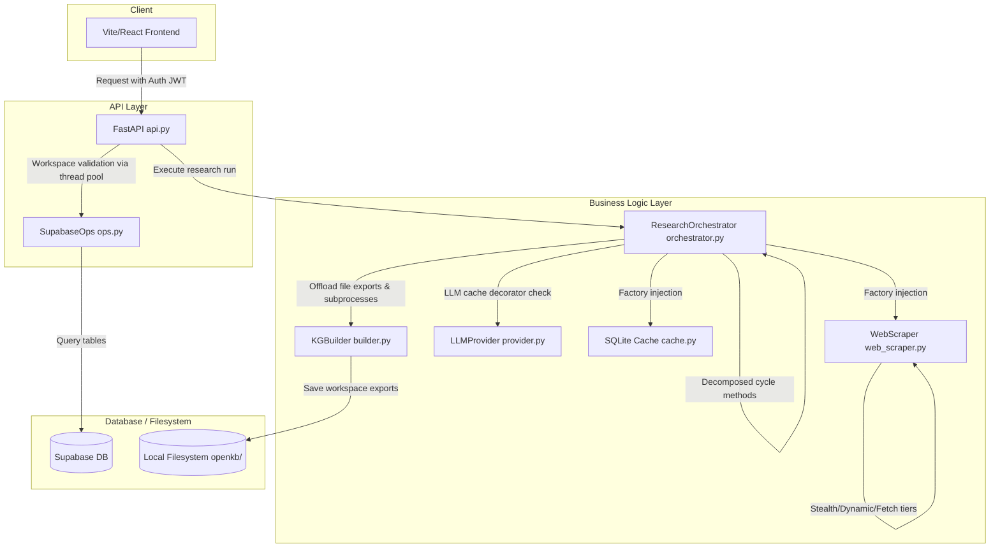

# refactor: Comprehensive Code Hardening, Complexity Reduction, and Performance Optimization

## Summary
Implement security sanitization for SQL query interpolation and path traversal risk areas; refactor cyclomatic complexity hotspots in the research orchestrator and scraper; integrate LLM response caching and memory context limits; and clean up linting, type annotation, and configuration centralization issues.

---

## Problem Frame
A comprehensive review of the codebase identified critical path traversal, SQL injection, and parser vulnerabilities (P0), high cyclomatic complexity in core logic loops (P1), memory and sequential dependency latency bottlenecks (P1), and a large volume of auto-fixable lint/type issues (P2/P3). Resolving these systematically will protect the system against attacks, improve event-loop responsiveness, and reduce maintenance debt.

---

## Requirements

### Security & Sanitization
R1. The `find_backlinks` query in `research_engine/utils/wiki_links.py` must validate the format of the `target_title` parameter before passing it to the Postgrest `.ilike` filter.
R2. The `search_notes` query in `research_engine/api.py` must sanitize special query characters in the query variable `q` before generating the Postgrest `.or()` filter string.
R3. Directory and path writes in `research_engine/output/storage.py` must validate that the `run_id` parameter matches a strict UUID or safe alphanumeric format to prevent path traversal, acting as defense-in-depth alongside JWT ownership checks.
R4. Document upload endpoints in `research_engine/api.py` must validate upload file types (MIME-types) and enforce a maximum file size of 50MB.

### Code Complexity & Maintainability
R5. Cyclomatic complexity of `_run_cycle` and `_execute_research_loop` in `research_engine/agent/orchestrator.py` must be reduced below 15.
R6. Cyclomatic complexity of `fetch_page` and `_extract_content` in `research_engine/sources/web_scraper.py` must be reduced below 15.
R7. Deploy a standardized ESLint configuration file in the `frontend/` directory to enforce quality gates for TypeScript and React hooks.
R8. Migrate all remaining deprecated Pydantic V1 field constraint attributes in `research_engine/models.py` and `research_engine/api.py` to Pydantic V2 parameters.
R9. Fix all auto-fixable linting issues (including trailing whitespaces and unused imports) across Python files.

### Performance & Scaling
R10. Implement an LLM response cache layer (using SQLite or disk cache) with TTL support to cache non-volatile auxiliary LLM operations (intent classification, confidence scoring).
R11. Implement rolling memory window limits or selective content retention in the `ResearchContext` to prevent memory growth under deep cycles.
R12. Offload Knowledge Graph builder post-processing CPU tasks (subprocesses and rich exports) to asynchronous thread pools.

### Architecture & Design
R13. Move scattered magic numbers, default limits, and model parameters into a centralized configuration object loaded from `config.toml`.
R14. Decouple direct instantiation of the scraper and cache manager in `orchestrator.py` by introducing lightweight factory patterns or dependency injection containers.
R15. Abstract Knowledge Graph builder invocations in the orchestrator behind a service interface.
R16. Implement explicit transaction rollback and cleanup methods in the orchestrator to revert side effects (such as local directory creations or partial database runs) on execution failure.

---

## Key Technical Decisions

KTD1. SQL/Filter Sanitization:
- **Decision**: Filter out non-alphanumeric/non-punctuation characters from search inputs, and use a strict regex validation pattern `^[a-zA-Z0-9_\-\s\[\]]+$` for wiki link titles before passing to Postgrest query strings.
- **Rationale**: Direct string formatting inside Postgrest `.or()` or `.ilike()` filters can lead to syntax parsing errors or query logic bypass if users pass special characters (like commas or parentheses) that Postgrest uses for query parsing.

KTD2. Complexity Decomposition:
- **Decision**: Break down the large orchestrator and scraper loops into a series of smaller private functions, separating intent routing, result evaluation, data extraction, and retry orchestration into distinct methods.
- **Rationale**: Decomposing cyclomatic complexity makes code easier to test, reduces the cognitive load on future developers, and simplifies profiling.

KTD3. LLM Response Caching:
- **Decision**: Build an async decorator pattern for `LLMProvider` utilizing the local SQLite caching subsystem with a TTL of 12 hours.
- **Rationale**: Intent classification, auxiliary scoring, and formatting evaluation requests are highly repetitive and non-volatile, making them excellent candidates for semantic/exact prompt caches.

KTD4. Rolled Memory Context:
- **Decision**: Enforce a rolling window context in `ResearchContext` that preserves only the last $N$ research cycles in raw text, offloading older cycles to compressed summaries or citations.
- **Rationale**: Storing raw page contents and full HTML nodes for 30+ cycles leads to exponential memory growth and eventual OOMs on low-resource runtimes.

KTD5. Async Dependency Injection:
- **Decision**: Construct a simple factory container to supply `WebScraper` and cache instances to the orchestrator instead of direct instantiation.
- **Rationale**: Decoupling resource instantiation from class constructors allows clean mocking in unit tests.

---

## High-Level Technical Design



---

## Scope Boundaries

### Out of Scope
- Migrating the primary PostgreSQL database to a different provider.
- Implementing real-time Redis replication for cache layers (caching will utilize local SQLite caches).
- Replacing the UI styling with a new design system.

---

## Implementation Units

### U1. Security Sanitization and Validation
- **Goal**: Resolve SQL injection risk vectors in `wiki_links.py` and `api.py`, path traversal risks in `storage.py`, and implement upload validation limits.
- **Files**:
  - `research_engine/utils/wiki_links.py` (Modify `find_backlinks` input checks)
  - `research_engine/api.py` (Sanitize search input `q` in `/notes/search` and add upload size/MIME validation)
  - `research_engine/output/storage.py` (Add regex validation for `run_id`)
- **Test File**: `tests/research/test_security_sanitization.py`
- **Test Scenarios**:
  - **Given**: A search input `q` with special characters (like commas, parenthesis, or quotes).
  - **When**: Querying `search_notes` fallback ILIKE logic.
  - **Then**: Verify that inputs are sanitized and no syntax error or query bypass is triggered.
  - **Given**: A document upload request.
  - **When**: File size is >50MB or MIME-type is not in the allowed set.
  - **Then**: Raise a `413 Payload Too Large` or `415 Unsupported Media Type` HTTP exception.

### U2. Orchestrator and Scraper Complexity Decomposition
- **Goal**: Refactor complex nested execution loops in `orchestrator.py` and `web_scraper.py` to reduce cyclomatic complexity below 15.
- **Files**:
  - `research_engine/agent/orchestrator.py` (Split `_run_cycle` and `_execute_research_loop`)
  - `research_engine/sources/web_scraper.py` (Split `fetch_page` and `_extract_content` helper methods)
- **Test File**: `tests/research/test_complexity_refactor.py`
- **Test Scenarios**:
  - **Given**: The refactored orchestrator code.
  - **When**: Running standard research loops.
  - **Then**: Confirm all pipeline outcomes (decisions, query generation, research progress streams) behave identically.
  - **Given**: The refactored scraper code.
  - **When**: Scraping diverse sites using stealthy/dynamic fallback fetchers.
  - **Then**: Confirm that parsing, fallback mechanics, and content extraction are identical to original functionality.

### U3. LLM Caching and Memory Optimizations
- **Goal**: Introduce semantic LLM prompt caching and restrict rolling context memory allocations.
- **Files**:
  - `research_engine/llm/provider.py` (Add SQLite LLM response cache decorator)
  - `research_engine/agent/orchestrator.py` (Implement rolling cycle constraints on memory context)
- **Test File**: `tests/research/test_llm_caching.py`
- **Test Scenarios**:
  - **Given**: An active research run with repeating intent classification queries.
  - **When**: Executing subsequent runs of identical queries.
  - **Then**: Confirm that cached LLM responses are served, and verify SQLite hits.
  - **Given**: A deep research run reaching 30 cycles.
  - **When**: Accessing the `ResearchContext` history.
  - **Then**: Verify that older raw text pages are summarized or discarded, maintaining context bounds.

### U4. Observability and Architecture Decoupling
- **Goal**: Implement thread-pool offloading for Knowledge Graph generation, configure frontend ESLint, centralize variables, factories, and rollback mechanisms.
- **Files**:
  - `research_engine/agent/orchestrator.py` (Add clean factory instantiation and rollback hooks)
  - `research_engine/knowledge_graph/builder.py` (Offload build steps to async pools)
  - `research_engine/models.py` (Clean up Pydantic V2 warnings)
  - `research_engine/config.py` (Centralize configuration attributes)
  - `frontend/eslint.config.js` (Deploy lint configuration)
- **Test File**: `tests/research/test_architecture_decoupling.py`
- **Test Scenarios**:
  - **Given**: A failed research run execution mid-loop.
  - **When**: The orchestrator encounters a runtime error.
  - **Then**: Execute cleanup hooks and verify local temp folders and incomplete database runs are cleaned.
  - **Given**: A Knowledge Graph generation request.
  - **When**: Triggering the build method.
  - **Then**: Verify that execution runs inside an async thread pool and does not block the FastAPI event loop.

---

## Verification Plan

### Automated Tests
Execute the pytest suite to verify all unit, integration, and security checks are green:
```powershell
# Run the entire test suite including new test scenarios
.\.venv\Scripts\pytest

# Run specific security and sanitization checks
.\.venv\Scripts\pytest tests/research/test_security_sanitization.py
```

### Manual Verification
- Deploy the frontend ESLint configuration locally and run `npm run lint` in the `frontend` folder to ensure code quality rules compile.
- Trigger a mock deep research execution via Swagger docs and verify memory footprint remains bounded.
