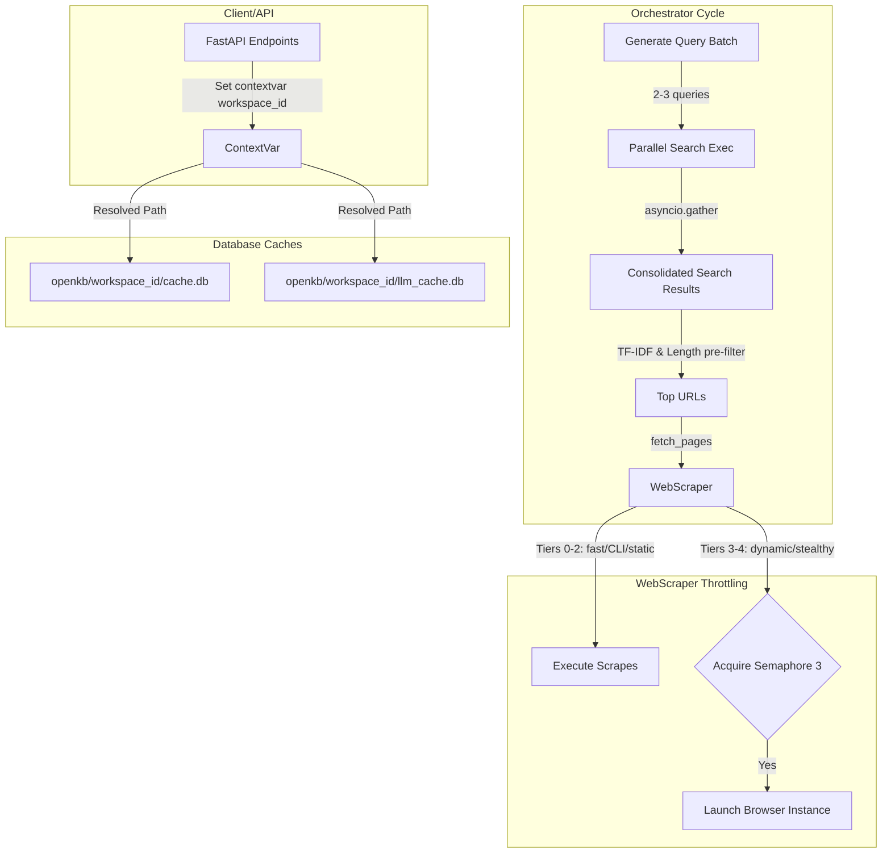

# Next-Gen Performance Optimization Plan

Implement a suite of speed and data extraction optimizations across the deep research pipeline, addressing cache partitioning, non-blocking DB concurrency, parallel query execution, TF-IDF snippet pre-filtering, and browser scraper semaphores.

## Problem Frame

The deep research agent currently operates with high query latencies, blocking SQLite connections, and unpartitioned caches. When running research, the lack of parallel sub-query execution increases overall run times. Heavy browser-based scraping fallbacks can trigger concurrent storms, leading to Out of Memory (OOM) failures or long hangs. Additionally, cache data is shared globally rather than being isolated by user workspace, presenting security concerns.

## Requirements

### Caching and Isolation
- R1. Cache isolation: Both `.llm_cache.db` and `outputs/cache.db` must be partitioned by `workspace_id`.
- R2. Non-blocking SQLite I/O: All SQLite queries must execute asynchronously in worker threads without blocking the event loop.
- R3. SQLite concurrency protection: WAL mode and busy timeouts must be enabled to prevent database locks.

### Pipeline Speed and Data Extraction
- R4. Intra-cycle parallel query execution: A single research cycle must be able to generate and run 2-3 search queries in parallel.
- R5. Snippet pre-filtering: Implement a pure Python TF-IDF and length check to pre-filter and score search snippets.
- R6. Browser fallback throttling: Throttling dynamic browser scraper tasks to a maximum of 3 concurrent browser instances.

---

## Key Technical Decisions

- KTD1. ContextVar for Workspace ID: Use `contextvars.ContextVar` in `research_engine/config.py` to hold the current workspace ID, populated by route handlers in `research_engine/api.py`.
- KTD2. Property-based SQLite DB Paths: In `LLMSQLiteCache` and `CacheManager`, determine database paths dynamically using the contextvar (`openkb/{workspace_id}/llm_cache.db` and `openkb/{workspace_id}/cache.db`).
- KTD3. Batch Query Generation: Add `generate_query_batch` in `research_engine/agent/searcher.py` utilizing a new prompt template to request 2-3 optimal sub-queries in one structured LLM call.
- KTD4. Browser Semaphore: Throttling browser page fetches in `WebScraper` using an internal `asyncio.Semaphore(3)`.

---

## High-Level Technical Design

---

## Implementation Units

### U1. Model and Prompt Additions
- **Goal:** Add Pydantic model for batch query generation and the batch generation prompt template.
- **Files:**
  - `research_engine/models.py`
  - `research_engine/llm/prompts.py`
- **Test Scenarios:**
  - Verify `SearchQueryBatch` parses lists of `SearchQuery` objects correctly.

### U2. Batch Query Generation
- **Goal:** Implement query batching in the searcher module.
- **Files:**
  - `research_engine/agent/searcher.py`
- **Test Scenarios:**
  - Verify `generate_query_batch` invokes the LLM using the batch template and returns 2-3 structured queries.

### U3. Workspace Cache Isolation & Async WAL SQLite
- **Goal:** Implement contextvar-based workspace partitioning, async thread-safe execution, and WAL config.
- **Files:**
  - `research_engine/config.py`
  - `research_engine/llm/provider.py`
  - `research_engine/sources/cache.py`
  - `research_engine/api.py`
- **Test Scenarios:**
  - Test that setting `workspace_id_var` directs SQLite cache databases to the corresponding `openkb/{workspace_id}/` directories.
  - Verify WAL mode and busy timeouts are successfully executed on sqlite connect.
  - Verify that DB calls are run asynchronously via `asyncio.to_thread`.

### U4. Python TF-IDF Pre-filtering
- **Goal:** Add TF-IDF snippet pre-filtering and junk filtering.
- **Files:**
  - `research_engine/agent/searcher.py`
- **Test Scenarios:**
  - Test snippet scorer on sample snippets, ensuring empty or tiny snippets (<20 chars) get 0.0 relevance.

### U5. Browser Scraper Throttling
- **Goal:** Implement the semaphore restriction for dynamic browser scraping fallbacks.
- **Files:**
  - `research_engine/sources/web_scraper.py`
- **Test Scenarios:**
  - Test concurrent requests of browser-based scraping, verifying that no more than 3 browser tasks run concurrently.

### U6. Parallel Query execution loop
- **Goal:** Integrate query batching and parallel execution into the orchestrator loop.
- **Files:**
  - `research_engine/agent/orchestrator.py`
- **Test Scenarios:**
  - Run full research cycles with 2-3 queries in parallel, ensuring pages are scraped concurrently and deduplicated.

---

## Verification Plan

### Automated Tests
- Run existing tests: `pytest tests/test_cache.py`
- Write new unit tests: `tests/test_performance_optimizations.py` testing workspace isolation, TF-IDF scoring, and batch query generation.

### Manual Verification
- Launch the main FastAPI server and execute deep research tasks. Verify in the logs that SQLite databases are initialized in workspace directories (e.g. `openkb/dev-workspace/cache.db`) and queries are run in parallel.
